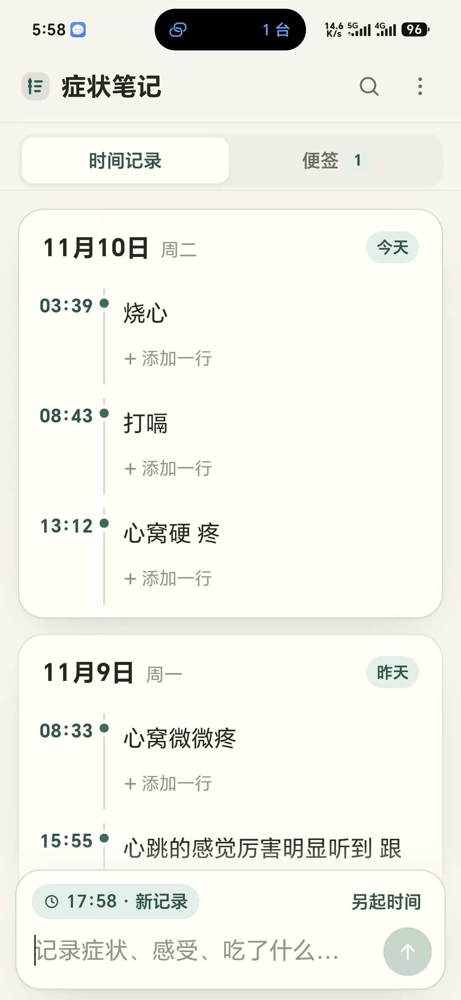
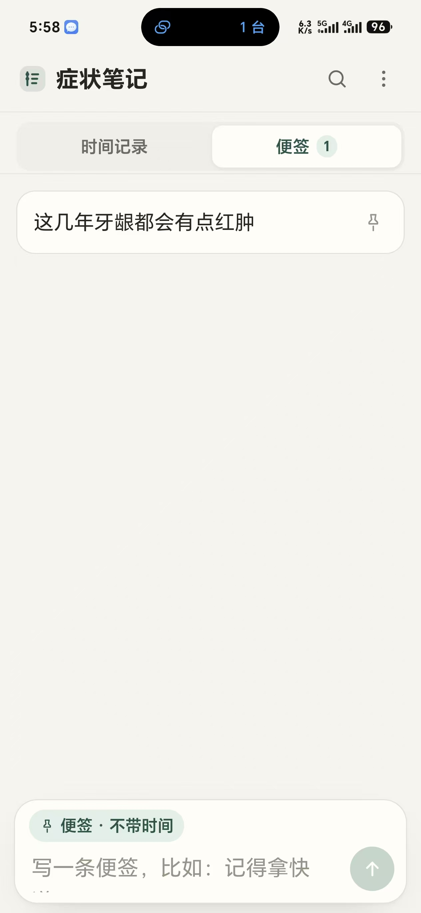

# 症状笔记 | Symptom Notes

## 应用示例 | App Examples

以下图片展示时间记录与便签两种使用方式。

<table>
  <tr>
    <th>时间记录 · Daily Logs</th>
    <th>便签 · Notes</th>
  </tr>
  <tr>
    <td></td>
    <td></td>
  </tr>
</table>

一款离线使用、本地保存的安卓应用，用来按天记录身体症状，也可以写日常便签。无广告，不申请联网权限。

[**下载安卓安装包 · Download APK**](https://github.com/780323007/-symptom-notes/releases/latest)

## 主要功能 | Features

- **按天记录**：当天内容展开显示，同一时间下可以填写多行，时间支持自动记录和手动调整。
- **独立便签**：与时间记录分开，重要内容可以置顶。
- **查找与整理**：支持搜索、编辑、删除及字体大小调整。
- **备份与导出**：支持导出、导入 JSON 备份，以及导出 Markdown 文本。

## 安装与备份 | Installation & Backup

支持 **Android 10 及以上**。打开下载页，在 **Assets（资源）** 中下载 `symptom-notes.apk`，传到手机后打开安装；如系统提示，请允许当前浏览器或文件管理器安装未知来源应用。

**卸载应用或清除应用数据会删除记录，请先在“更多”菜单中导出备份；更换手机时可通过导入备份迁移。**

问题反馈与功能建议：[Issues](https://github.com/780323007/-symptom-notes/issues)。
