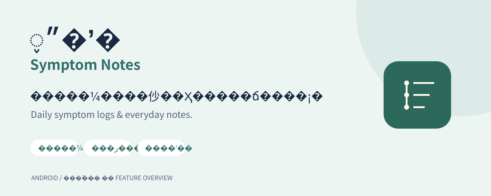
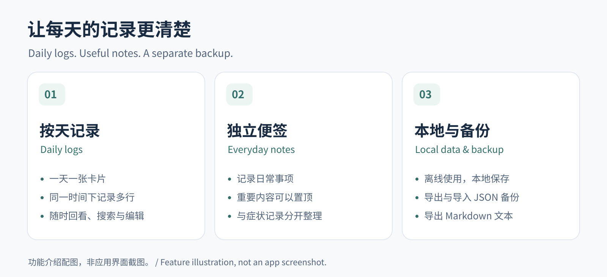

# 症状笔记 | Symptom Notes

**按天记录身体变化，也记下日常琐事。**  
A simple Android app for daily symptom logs and everyday notes.

[**下载安卓安装包 · Download APK**](https://github.com/780323007/-symptom-notes/releases/latest) · [查看发行版本 · Releases](https://github.com/780323007/-symptom-notes/releases)

症状笔记将带时间的症状记录与普通便签放在两个独立界面中。你可以按天查看身体变化，也可以记下待办事项；记录保存在手机本地，应用支持离线使用。

Symptom Notes keeps timestamped symptom logs and everyday notes in separate views. Review your entries by day, keep useful notes close at hand, and save your data locally on your phone.

## 功能介绍 | Features

| 功能 | 说明 |
| --- | --- |
| 按天记录 · Daily logs | 一天一张卡片，当天内容展开显示，方便回看。 |
| 时间分组 · Timestamp groups | 同一时间下可以记录多行内容，支持自动记录时间和手动调整。 |
| 独立便签 · Everyday notes | 便签与症状记录分开，重要便签可以置顶。 |
| 搜索与编辑 · Search and edit | 支持搜索、修改和删除记录。 |
| 字体调整 · Adjustable text size | 可按阅读习惯调整字体大小。 |
| 备份与导出 · Backup and export | 支持导出、导入 JSON 备份，以及导出 Markdown 文本。 |

*以上为功能介绍配图，并非应用界面截图。Images above illustrate the app's features; they are not interface screenshots.*

## 下载安装 | Installation

1. 打开 [最新发行版本](https://github.com/780323007/-symptom-notes/releases/latest)。
2. 在 **Assets（资源）** 中下载 **symptom-notes.apk**。
3. 在安卓手机上打开文件并安装。如果系统提示，允许当前浏览器或文件管理器安装未知来源应用。

**系统要求：Android 10 及以上。**

Download **symptom-notes.apk** from the [latest release](https://github.com/780323007/-symptom-notes/releases/latest), then open it on your Android phone to install. Allow installation from your browser or file manager if prompted. Requires Android 10 or later.

## 开始记录 | Getting started

- **时间记录**：输入身体症状或其他想记录的内容；同一时间块可以包含多行记录，必要时手动另起时间。
- **便签**：切换到便签界面，记录日常事项，将重要内容置顶。
- **备份**：在“更多”菜单中导出 JSON 备份，需要恢复时再导入。

Use the daily log for timestamped entries and the notes view for everyday reminders. Export a JSON backup from the More menu to keep a separate copy of your data.

## 本地保存与备份 | Local storage and backup

安卓 APK 离线运行，不申请联网权限，无广告。记录保存在应用的本地私有文件中。

**卸载应用、清除应用数据或更换手机前，请先导出备份。** 本地保存不等于自动云备份；卸载或清除应用数据会删除记录。

The Android APK works offline, requests no internet permission, and contains no ads. Entries are stored in the app's private local files. **Export a backup before uninstalling the app, clearing its data, or moving to another phone.** Local storage does not provide automatic cloud backup.

## 问题与建议 | Feedback

欢迎通过 [Issues](https://github.com/780323007/-symptom-notes/issues) 反馈使用问题或提出建议。提交反馈时，请避免附上个人症状记录或其他隐私内容。

Report problems or suggest improvements through [Issues](https://github.com/780323007/-symptom-notes/issues). Please leave personal health entries and other private information out of public reports.
